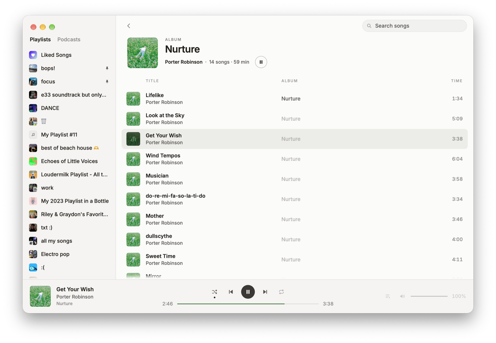
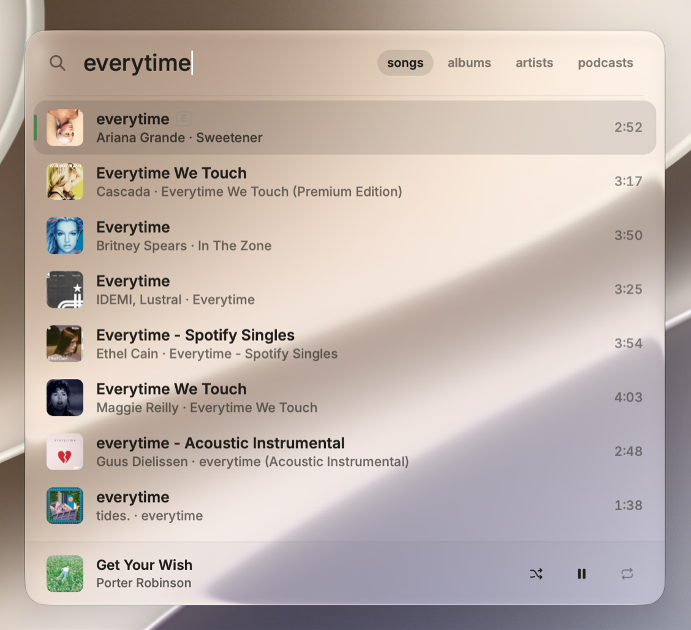

# spot

Tiny Spotify player for the Mac: playlists, Liked Songs, search, albums, artists and podcasts,
with audio streamed by [librespot](https://github.com/librespot-org/librespot), so no Spotify app
is needed. A native window drawn with [Rune](https://github.com/anomalyco/rune), `⌥Space` search
from any app, and a command line for scripts and agents. Needs Spotify Premium and an Apple
Silicon Mac (macOS 14+, Liquid Glass on 26+).

## Install

Build it from source. You need a Rust toolchain (https://rustup.rs) and the Xcode command line
tools (`xcode-select --install`):

    git clone https://github.com/boopdotpng/spot && spot/macos/bundle.sh

That installs `Spot.app` to `~/Applications` (set `SPOT_APP_DIR` to change) and links `spot` in
`~/.local/bin` (set `SPOT_INSTALL_DIR` to change) to the binary inside it. It also has spot start
at login without its window, so `⌥Space` always works (`macos/bundle.sh --no-login` leaves that
out; the login item is `~/Library/LaunchAgents/com.github.boopdotpng.spot.plist`), and removes
the separate `Spot Launcher.app` from versions before 2.0. The first build takes a few minutes.
To update, `git pull` and run `macos/bundle.sh` again, then `spot quit` and `spot`.
Builds use `--locked`: vergen is pinned to 9.0.x in Cargo.lock, and librespot-core 0.8 fails to
build with vergen 9.1.

Using Claude Code or Codex? Point it at this repo and ask it to build and install spot:
[AGENTS.md](AGENTS.md) tells it how.

## First run

spot needs a Spotify app of your own (free, takes a minute). On first start it asks for one:

1. Open https://developer.spotify.com/dashboard and create an app.
2. Add the redirect URI `http://127.0.0.1:19872/login`.
3. Tick **Web API** and save.
4. Paste the app's Client ID when spot asks for it.

It's saved as `client_id` in `~/.config/spot/config.toml` (change it in Settings, `⌘,`, or set
`SPOT_CLIENT_ID` to override). Using a different redirect URI? Set `SPOT_REDIRECT` to match.
Then log in through the browser; there's one more one-time approval for the audio session.
**Log out** in Settings (`⌘,`) forgets both logins and restarts spot, which asks again.

## Last.fm (optional)

Skip this section if you don't use Last.fm; scrobbling stays off unless it's set up.
spot can scrobble what you play to Last.fm:

1. Create an API account at https://www.last.fm/api/account/create with callback URL
   `http://127.0.0.1:19872/lastfm` (same host and port as `SPOT_REDIRECT`, if you changed it).
2. Open Settings (`⌘,`), paste the API key and shared secret under Last.fm, and press **Connect**.
   Approve spot in the browser (once; the session is kept in `~/.cache/spot/lastfm_session`).
   The keys are saved to `~/.config/spot/lastfm`, one per line; `LASTFM_API_KEY` and
   `LASTFM_SECRET` work too. **Disconnect** stops scrobbling and keeps the keys.
   Press `enter` to skip the approval and start without scrobbling.

To turn scrobbling off without deleting the keys, set `SPOT_LASTFM=off`.

Last.fm's rules apply: tracks over 30s scrobble once you've played half of them or 4 minutes,
whichever comes first. Only time actually playing counts, so seeking ahead doesn't. The song
shows as "now playing" on your profile while it plays. Scrobbles that can't be sent (offline)
wait in `~/.cache/spot/scrobbles` and go out later.

## The window

`spot` opens it. The sidebar lists your playlists (or podcasts), the middle the open list with
each song's cover (and, in playlists, when it was added), and the player runs along the bottom.
The window is near-monochrome: the covers are its color, and a single accent, taken from the
playing song's cover, marks what's playing and fills the progress bar. Click a playlist to open it, double-click a song to play it (the rest of the
list plays after it); click the playing song's name for its album, the artist for their page.
Closing the window (`⌘W`) keeps the music playing; `⌘Q` quits.

| key | action |
|---|---|
| `/`, `⌘K` | search as you type (`tab` in the field cycles songs / albums / artists / podcasts, `↑`/`↓` move, `enter` keeps the results, `esc` goes back) |
| `enter` | play song (the rest of the list plays after it) · open album / artist |
| `d` | playlists: sort by date added (newest first, oldest first, as listed); also the DATE ADDED column's head; remembered |
| `⌘F` | filter the open list; `enter` plays the match but keeps the whole list playing, `esc` closes |
| `space` | pause / resume (with a short volume fade); right after launch, resumes what was playing at quit |
| `s` | shuffle on/off |
| `r` | repeat: off → repeat list → repeat one song |
| `P` | play the whole open list (from a random song if shuffle is on) |
| `n` / `p` | next / previous (previous restarts the song if >3s in) |
| `,` / `.` | seek −10s / +10s |
| `+` / `-` | volume |
| `o` | jump to the list that's playing |
| `e` | add the highlighted song to the queue (queued songs play before the list carries on) |
| `Q` | up next: the queue, then the rest of the list. `enter` plays a song from it now, `x` removes a queued one |
| `m` | switch the sidebar between playlists and podcasts |
| `a` / `A` | go to the album / artist of the highlighted song (or the playing one, from the sidebar) |
| `v` | on an artist page: overview → all songs → discography |
| `f` | on an artist's overview or discography: all → albums (incl. EPs) → singles (remembered) |
| `esc`, `backspace` | back to the previous list |
| `tab`, `h`/`l`, `←`/`→` | switch pane (on cards, `h`/`l` move card to card; left off a line's first card goes to the sidebar) |
| `j`/`k`, `↑`/`↓`, `ctrl+d`/`ctrl+u` | move |
| `g` / `M` / `G` (also `home` / `end`) | jump to top / middle / bottom of the list |
| `⌘?` | key help (any key closes it) |
| `⌘O` | the `⌥Space` search |
| `⌘W` | close the window; music keeps playing (`spot`, `⌥Space` then `⌘O`, or opening Spot.app brings it back) |
| `⌘Q` | quit |

Media keys and the macOS Now Playing widget work too.

## ⌥Space

Searches and plays from any app: `⌥Space` opens a Liquid Glass bar near the top of the screen
you're on, with what's playing under the results. Type to search, `tab` cycles songs / albums /
artists / podcasts, `↑`/`↓` move, `enter` plays (pressed before the results are in, it plays the
first one), `⌘enter` adds to the queue, `⌘c` copies the selected result's open.spotify.com link
(with no results, the playing song's), `ctrl+s` / `ctrl+r` toggle shuffle / cycle repeat (or
click the icons beside what's playing; the play icon pauses), `⌘o` opens spot's window, `esc`
closes. Settings (`⌘,`) changes `⌥Space`.

## Command line

Only one spot plays at a time. Running `spot` starts spot if needed and opens its window; when
it's already running, `spot` brings that window up. Control the running one from any terminal,
script or agent (an LLM can drive it from `spot help` alone):

    spot search daft punk            # songs (--albums, --artists, --playlists; -n 20), numbered, with uris
    spot play 1                      # the first result of the last search
    spot play spotify:track:…        # plays now, then the queue and the list carry on
    spot play spotify:album:…        # album / artist / playlist: replaces the list (--from <song uri>, --show)
    spot play liked                  # or one of your playlists by name
    spot play black beatles          # not a playlist of yours: the top song on Spotify
    spot play album abbey road       # or artist / song / playlist: the top one of those
    spot pause | play | toggle | next | prev
    spot seek 1:30 | +10 | -10
    spot vol 60 | +10 | -10
    spot shuffle [on|off] · spot repeat [off|all|one]
    spot queue                       # the queue, then the list's next songs
    spot queue 2 5                   # add results, uris, or a whole album / playlist to the queue (= `queue add`)
    spot queue add --at 1 <what>     # the same, in at a position of the queue (1 plays next)
    spot queue rm 1 5-8              # remove by number, range or uri
    spot queue mv 3-5 1              # move songs to a position, in order (numbers, ranges or uris)
    spot queue clear
    spot status · spot playlists · spot podcasts
    spot search hard fork --podcasts # or --episodes
    spot play podcast hard fork      # or episode, or a spotify:show: / spotify:episode: uri

Spotify's field filters work in searches: `spot search 'track:one more time artist:daft punk'`,
`spot search 'artist:radiohead year:1997' --albums`.
`spot play <words>` plays the top hit and says what it picked; to choose yourself, `spot search`
first, then play a result by its number (`spot play 3`, `spot queue add 2 5`) or uri. When several
of your playlists match, it lists them numbered, for `spot play N`.

The queue is spot's own, like Spotify's: songs you add play in order before the list you're
playing carries on, and it's kept across restarts. `spot play <song>` plays a song right away
and then goes on with the queue. Spotify links work
anywhere a uri does. Exit code 3 means spot isn't running.

`spot watch` prints a line per event as it happens: `track` (a new song), `playing`, `paused`,
`modes` (shuffle or repeat changed), `skip` (a media key skipped or seeked), `end` (nothing left to play) and `ending`, sent 30 seconds (`--before`) before a song ends with
what's next, so there's time to `spot queue add` something. It works as a monitor target
for agents. `spot wait ending` blocks until the next one and exits.

### Claude Code

The repo ships a skill ([`docs/skills/spot`](docs/skills/spot/SKILL.md)) so Claude Code can play music for you. To use it
in every project, copy it from your clone:

    mkdir -p ~/.claude/skills && cp -r docs/skills/spot ~/.claude/skills/

### Without a window

`spot start` starts spot in the background with no window and returns once it's ready, so a
script or an agent (Claude Code's Bash tool, say) can start it and carry on; `⌥Space` works, and
`spot` opens the window. `spot quit` stops it, keeping the resume point. Log in once by running
`spot` in a terminal first. (The login item runs `spot --app`, the same in the foreground.) Media keys and Now Playing work without the
window too, and with it closed spot draws nothing: it uses about as little as before it had one.

The CLI and the window drive the same player, so they work at the same time: the window shows
what the CLI changed, and `--show` also opens the list it played. It talks to spot over a Unix
socket at `~/.cache/spot/sock`.

## Podcasts

`m` switches the sidebar to podcasts: **Continue listening** (episodes part way through, last
played first), **New episodes** (the latest few unheard ones of each show you follow, newest
first), then the shows you follow, which you follow in Spotify itself. Opening a show lists its
episodes, newest first, with their dates and what's left of them.

Episodes pick up where you left off, and count as played in their last minute. That's kept in
`~/.cache/spot/episodes` and isn't shared with Spotify's apps, and Settings' Clear cache leaves it alone.
They play in list order, so the next one is older, whatever shuffle says. They don't scrobble.
`a` or `A` on one opens its show. Audio is what Spotify streams for podcasts, usually 96 kbps.
Video podcasts play as audio if Spotify has an audio version.

## Config

Settings (`⌘,`) covers audio quality, the song cache's size, the
`⌥Space` key, and the Spotify and Last.fm logins. They're saved in
`~/.config/spot/config.toml`. See
[docs/config.md](docs/config.md) for every key.

Right-click a playlist in the sidebar to pin it to the top.

## Notes

- **Shuffle** is a uniform Fisher–Yates shuffle of the whole list (OS-seeded ChaCha RNG):
  every order is equally likely, no artist/popularity weighting. The playing song stays first.
  With repeat on, each pass through the list gets a fresh shuffle.
- **Artists** open on an overview: their portrait, popular songs, discography, what they appear on and related artists. Its play
  button (or `P`) shuffles every song they have. `v` goes on to every song (albums + singles/EPs, newest first, duplicate single/album versions
  removed: find, sort and play from here) and to the discography as a grid of covers. `⌘F` on the overview finds in every song.
- **Quality**: 320 kbps Ogg Vorbis by default (`quality` in [config.toml](docs/config.md)), the highest librespot can stream. Spotify's lossless (FLAC)
  isn't exposed to third-party/Connect players, so librespot can't select it.
- Audio: librespot (no Spotify app needed).
- Playlist list, Liked Songs, search, podcasts: Web API through your own Spotify app (see First run).
- Playlist / album / artist contents: Spotify's internal metadata endpoints (dev-mode Web API
  apps can't read playlists you don't own).
- Login state lives in `~/.cache/spot` (delete it to log out).
- **Logs**: a detailed log (spot + librespot at debug, including why a track failed to play) is
  always written to `~/.cache/spot/log`; the previous run's is kept as `log.1`.
- **Startup**: playlists, Liked Songs and playlist contents are cached in `~/.cache/spot`, so
  they show instantly and refresh in the background (usually one request to confirm Liked Songs
  is current). The audio session connects in the background too.
- **Albums & artists** you've opened before (track lists and releases) also show instantly from
  the cache and refresh in the background.
- **Audio cache**: played songs are kept in `~/.cache/spot/audio` (as streamed, encrypted), so
  replaying them starts instantly without the network. Capped at 1 GB, least recently played
  dropped first; set `audio_cache_gb` in [config.toml](docs/config.md) to change the cap (`0` turns it off).
- **Clear cache** (in Settings) clears the caches (songs, playlist / album / artist lists) and
  restarts spot. Login, settings, the resume point and unsent scrobbles are kept.
- **Resume**: quitting saves the list, the queue, shuffle/repeat and position; next launch shows that song
  paused and preloads it once connected, so `space` starts it right away.
- **Colors**: light or dark follows macOS. The one accent comes from the playing cover, quietened,
  and falls back to grey with nothing playing.
- **Battery**: with the window closed spot draws nothing. Open, it draws only when something
  changes: once a second while playing (the clock and the progress bar), never while paused.

## Releasing

Bump `version` in `Cargo.toml` (and run `cargo build` so `Cargo.lock` follows), commit, then
write the release notes (markdown) and tag with them, and push:

    git tag -a v1.1.0 --cleanup=verbatim -F notes.md && git push origin master v1.1.0

(`--cleanup=verbatim` keeps the `## ` headings, which git would otherwise strip as comments.)

The release workflow is turned off for now (`gh workflow enable release` turns it back on). When
it's on, it builds `Spot.app` for Apple Silicon on each tag (with `cargo build --profile dist`:
the fully optimized build, which `bundle.sh` skips to rebuild in seconds) and publishes it as
`Spot.zip` on the release, with the tag's message as its notes (a tag without one fails the
release). Pushes to master also build (no release) to keep the Rust cache warm; changes to only
`.md` files skip CI.
