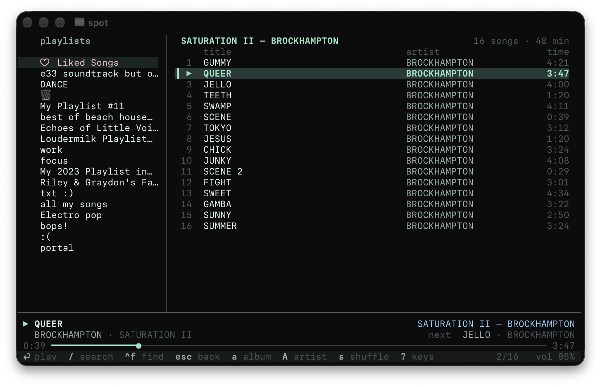
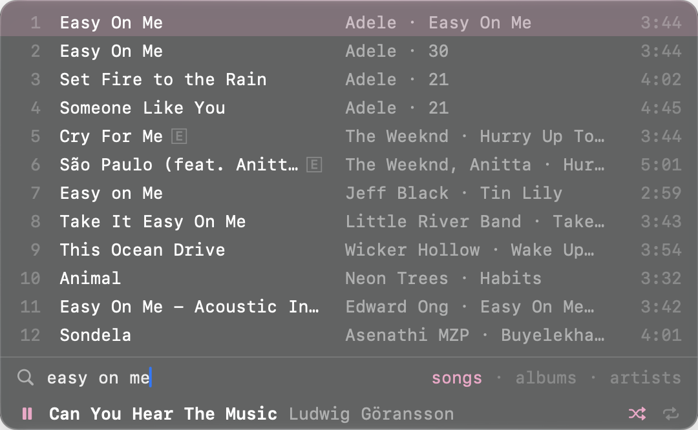

# spot

Tiny Spotify TUI: playlists, Liked Songs, search, albums and artists, with audio streamed by
[librespot](https://github.com/librespot-org/librespot), so no Spotify app is needed.
Needs Spotify Premium. macOS and Linux.

## Install

Prebuilt binaries for Apple Silicon macOS and x86_64 Linux:

    curl -fsSL https://raw.githubusercontent.com/boopdotpng/spot/master/install.sh | sh

It installs to `~/.local/bin/spot` (set `SPOT_INSTALL_DIR` to change). Run it again to update.

On anything else (Intel Macs, ARM Linux), or to build from source, use cargo (needs a Rust toolchain, https://rustup.rs):

    cargo install --locked --git https://github.com/boopdotpng/spot

Use `--locked`: vergen is pinned to 9.0.x in Cargo.lock, and librespot-core 0.8 fails to build
with vergen 9.1.

On macOS there's also a `⌥Space` launcher to search and play from any app; see
[macOS launcher](#macos-launcher-space).

### Linux dependencies

ALSA, OpenSSL and D-Bus (audio, HTTPS, and MPRIS media keys). The prebuilt binary needs the
runtime libraries (usually already installed); building from source needs the headers:

    # Debian / Ubuntu
    sudo apt install build-essential pkg-config libasound2-dev libssl-dev libdbus-1-dev
    # Fedora
    sudo dnf install gcc pkg-config alsa-lib-devel openssl-devel dbus-devel
    # Arch
    sudo pacman -S base-devel pkgconf alsa-lib openssl dbus

## First run

spot needs a Spotify app of your own (free, takes a minute). On first start it asks for one:

1. Open https://developer.spotify.com/dashboard and create an app.
2. Add the redirect URI `http://127.0.0.1:19872/login`.
3. Tick **Web API** and save.
4. Paste the app's Client ID when spot asks for it.

It's saved to `~/.config/spot/client_id` (delete it to set up again, or set `SPOT_CLIENT_ID`
to override). Using a different redirect URI? Set `SPOT_REDIRECT` to match.
Then log in through the browser; there's one more one-time approval for the audio session.

## Last.fm (optional)

Skip this section if you don't use Last.fm; scrobbling stays off unless it's set up.
spot can scrobble what you play to Last.fm:

1. Create an API account at https://www.last.fm/api/account/create with callback URL
   `http://127.0.0.1:19872/lastfm` (same host and port as `SPOT_REDIRECT`, if you changed it).
2. Put the API key and shared secret in `~/.config/spot/lastfm`, one per line (or set
   `LASTFM_API_KEY` and `LASTFM_SECRET`).
3. Start spot and approve it in the browser (once; the session is kept in `~/.cache/spot/lastfm_session`).
   Press `enter` to skip the approval and start without scrobbling.

To turn scrobbling off without deleting the keys, set `SPOT_LASTFM=off`.

Last.fm's rules apply: tracks over 30s scrobble once you've played half of them or 4 minutes,
whichever comes first. Only time actually playing counts, so seeking ahead doesn't. The song
shows as "now playing" on your profile while it plays. Scrobbles that can't be sent (offline)
wait in `~/.cache/spot/scrobbles` and go out later.

## Keys

| key | action |
|---|---|
| `/` | search (`tab` in the prompt cycles songs / albums / artists) |
| `enter` | play song (the rest of the list plays after it) · open album / artist |
| `ctrl+t` | next theme (desert, lagoon, moss, iris, blossom, mint, sorbet); remembered, light/dark still follows the terminal |
| `ctrl+f` | filter the open list; `enter` plays the match but keeps the whole list playing, `esc` closes |
| `space` | pause / resume (with a short volume fade); right after launch, resumes what was playing at quit |
| `s` | shuffle on/off |
| `r` | repeat: off → repeat list → repeat one song |
| `P` | play the whole open list (from a random song if shuffle is on) |
| `n` / `p` | next / previous (previous restarts the song if >3s in) |
| `,` / `.` | seek −10s / +10s |
| `+` / `-` | volume |
| `o` | jump to the list that's playing |
| `e` | add the highlighted song to the queue (queued songs play before the list carries on) |
| `Q` | show the queue: `enter` plays a song from it now, `x` removes one |
| `a` / `A` | go to the album / artist of the highlighted song (or the playing one, from the playlist pane) |
| `v` | on an artist page: all songs ↔ albums & singles (remembered) |
| `f` | on an artist's releases: all → albums (incl. EPs) → singles (remembered) |
| `esc`, `backspace` | back to the previous list |
| `tab`, `h`/`l`, `←`/`→` | switch pane |
| `j`/`k`, `↑`/`↓`, `ctrl+d`/`ctrl+u` | move |
| `g` / `M` / `G` (also `home` / `end`) | jump to top / middle / bottom of the list |
| `?` | key help (any key closes it) |
| `q` | quit |

Media keys and the macOS Now Playing widget work too.

## Command line

Only one spot plays at a time; starting a second one says so. Instead, control the running one
from any terminal, script or agent (an LLM can drive it from `spot help` alone):

    spot search daft punk            # songs (--albums, --artists, --playlists; -n 20), numbered, with uris
    spot play 1                      # the first result of the last search
    spot play spotify:track:…        # plays now, then the queue and the list carry on
    spot play spotify:album:…        # album / artist / playlist: replaces the list (--from <song uri>, --show)
    spot play liked                  # or one of your playlists by name
    spot play black beatles          # not a playlist of yours: the top song on Spotify
    spot play album abbey road       # or artist / song / playlist: the top one of those
    spot pause | play | toggle | next | prev
    spot seek 1:30 | +10 | -10
    spot vol 60 | +10 | -10
    spot shuffle [on|off] · spot repeat [off|all|one]
    spot queue                       # the queue, then the list's next songs
    spot queue 2 5                   # add results, uris, or a whole album / playlist to the queue (= `queue add`)
    spot queue rm 1 · spot queue clear
    spot status · spot playlists

Spotify's field filters work in searches: `spot search 'track:one more time artist:daft punk'`,
`spot search 'artist:radiohead year:1997' --albums`.
`spot play <words>` plays the top hit and says what it picked; to choose yourself, `spot search`
first, then play a result by its number (`spot play 3`, `spot queue add 2 5`) or uri. When several
of your playlists match, it lists them numbered, for `spot play N`.

The queue is spot's own, like Spotify's: songs you add play in order before the list you're
playing carries on, and it's kept across restarts. `spot play <song>` plays a song right away
and then goes on with the queue. Spotify links work
anywhere a uri does. Exit code 3 means spot isn't running.

`spot watch` prints a line per event as it happens: `track` (a new song), `playing`, `paused`,
`end` (nothing left to play) and `ending`, sent 30 seconds (`--before`) before a song ends with
what's next, so there's time to `spot queue add` something. It works as a monitor target
for agents. `spot wait ending` blocks until the next one and exits.

### Claude Code

The repo ships a skill (`.claude/skills/spot`) so Claude Code can play music for you. To use it
in every project, copy it into your skills:

    mkdir -p ~/.claude/skills && cp -r .claude/skills/spot ~/.claude/skills/

### Without a window

`spot start` starts the player in the background with no window and returns once it's ready,
so a script or an agent (Claude Code's Bash tool, say) can start it and carry on. `spot quit`
stops it, keeping the resume point like `q` does. Log in once by running `spot` in a terminal
first. (`spot --headless` is the same player in the foreground, for running it as a launchd or
systemd service.) Media keys and Now Playing work headless too.

The CLI and the keys drive the same player, so they work at the same time: the window shows what
the CLI changed, and `--show` also opens the list it played. It talks to spot over a Unix socket
at `~/.cache/spot/sock`.

## macOS launcher (⌥Space)

A small native app that searches and plays from anywhere: `⌥Space` opens a Liquid Glass bar at the
bottom of the screen, tinted with spot's `ctrl+t` theme, with what's playing under the search. Drag
it anywhere; it opens there next time. Type to search, `tab` cycles songs / albums / artists,
`↑`/`↓` move, `enter` plays (pressed before the results are in, it plays the first one), `⌘enter`
adds to the queue, `ctrl+s` / `ctrl+r` toggle shuffle / cycle repeat (or click the icons beside
what's playing; the play icon pauses), `esc` closes. It's a separate program that talks to the
running spot over its socket, and starts it (`spot start`) if it isn't running. About 18 MB of
memory, no CPU while hidden.

Build it from a clone (needs macOS 14+ and the Xcode command line tools, `xcode-select --install`):

    git clone https://github.com/boopdotpng/spot && spot/mac/build.sh

It installs to `~/Applications/Spot Launcher.app` (set `SPOT_LAUNCHER_DIR` to change), starts
it, and adds it to Login Items on first launch (remove it in System Settings → General → Login
Items). Run `build.sh` again to update. It needs a spot newer than 1.2.1: until the next release,
install spot with cargo (above), then quit and restart the player.

## Notes

- **Shuffle** is a uniform Fisher–Yates shuffle of the whole list (OS-seeded ChaCha RNG):
  every order is equally likely, no artist/popularity weighting. The playing song stays first.
  With repeat on, each pass through the list gets a fresh shuffle.
- **Artists** open as every song (`v` switches to their albums & singles, to pick one) and play their full discography (albums + singles/EPs, newest first, duplicate
  single/album versions removed). Shuffle + `P` = shuffle the whole discography.
- **Quality**: 320 kbps Ogg Vorbis, the highest librespot can stream. Spotify's lossless (FLAC)
  isn't exposed to third-party/Connect players, so librespot can't select it.
- Audio: librespot (no Spotify app needed).
- Playlist list, Liked Songs, search: Web API through your own Spotify app (see First run).
- Playlist / album / artist contents: Spotify's internal metadata endpoints (dev-mode Web API
  apps can't read playlists you don't own).
- Login state lives in `~/.cache/spot` (delete it to log out).
- **Logs**: a detailed log (spot + librespot at debug, including why a track failed to play) is
  always written to `~/.cache/spot/log`; the previous run's is kept as `log.1`.
- **Startup**: playlists, Liked Songs and playlist contents are cached in `~/.cache/spot`, so
  they show instantly and refresh in the background (usually one request to confirm Liked Songs
  is current). The audio session connects in the background too.
- **Albums & artists** you've opened before (track lists and releases) also show instantly from
  the cache and refresh in the background.
- **Audio cache**: played songs are kept in `~/.cache/spot/audio` (as streamed, encrypted), so
  replaying them starts instantly without the network. Capped at 1 GB, least recently played
  dropped first; set `SPOT_AUDIO_CACHE_GB` to change the cap (`0` turns it off).
- **`spot clean`** clears the caches (songs, playlist / album / artist lists) and prints how much
  it freed. Login, settings, the resume point and unsent scrobbles are kept.
- **Resume**: quitting saves the list, the queue, shuffle/repeat and position; next launch shows that song
  paused and preloads it once connected, so `space` starts it right away.
- **Theme**: picks a light or dark palette from the terminal's background color at startup
  (OSC 11; Ghostty, iTerm2, kitty, WezTerm, …) and follows live changes where the terminal
  reports them (Ghostty). Force one with `SPOT_THEME=light` / `dark`.
  `ctrl+t` cycles color themes, each with a light and dark variant.
  The status line sits on a faint tint of the terminal's own background (needs truecolor).
- **Layout**: playlists on the left, the open list (numbered rows) on the right, the player under
  a rule across the bottom, and a vim-style status line last: it holds the search / find prompts,
  notices, key hints for the focused pane, the cursor position and the volume. `?` swaps it for
  a key cheatsheet.

## Releasing

Bump `version` in `Cargo.toml` (and run `cargo build` so `Cargo.lock` follows), commit, then tag and push:

    git tag v1.1.0 && git push origin master v1.1.0

GitHub Actions builds Apple Silicon macOS and x86_64 Linux binaries and publishes the release
with generated notes; `install.sh` always fetches the latest one. Pushes to master also build
(no release) to keep the Rust cache warm; changes to only `.md` files skip CI.
